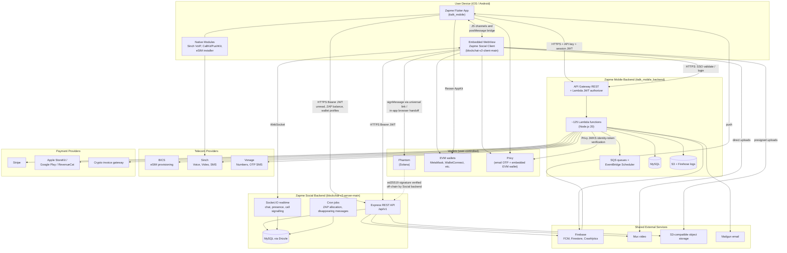

# zapmepublic
public repo for colosseum application


````markdown
# Zapme — Technical Architecture & Repository Overview

Zapme is a mobile-first communications platform. It combines telecom services (eSIM data plans, global virtual phone numbers, VoIP calling and cloud SMS) with **Zapme Social**, a wallet-enabled social and messaging network that runs inside the native app. Users can sign in with email, Google, Apple, an EVM wallet or a Phantom (Solana) wallet.

This README is a technical overview of the **four private repositories** behind Zapme, written for evaluation purposes. Every claim here was checked against the source code. Where something is only partly built or exists only as UI copy, the document says so.

---

## 1. Project Overview

Zapme targets travellers and globally mobile users who currently piece together a local SIM, a second phone number, messaging apps and crypto wallets from different vendors. The platform brings these together under one account:

- **Telecom layer.** Users buy and install eSIM data plans, rent virtual phone numbers in multiple countries, place and receive VoIP voice and video calls, and send and receive SMS on those numbers.
- **Commerce layer.** Purchases can be paid by card through Stripe, by Apple Pay or Google Pay, through Google Play billing, or with crypto through a third-party invoice gateway. A promotional-credits ledger and referral rewards sit alongside these.
- **Social layer (Zapme Social, also called BlockChat).** A full social network with a feed, posts, reels, stories, communities ("ZapZones"), direct and group chat, calls and notifications. Identity is wallet-centric, and a rewards system tracks "ZAP" points.
- **Identity layer.** Email, Google, Apple, Privy and Reown/WalletConnect single sign-on, plus Phantom wallet sign-in using Solana message signatures. All of these feed a single Zapme account that can hold several linked wallets.

The Android build ships in a dedicated **Solana dApp Store** flavour alongside the Google Play and App Store builds.

---

## 2. Repository Structure

| Repository | Technology | Responsibility |
|---|---|---|
| `italk_mobile` | Flutter (Dart), Provider + BLoC, `get_it`, `go_router`; custom Kotlin and Swift native modules | Zapme mobile frontend for iOS and Android: telecom, payments, native calling and eSIM, and the host for the embedded Zapme Social WebView |
| `italk_mobile_backend` | Node.js 20 on AWS Lambda, deployed with AWS SAM; API Gateway REST; MySQL (Knex) | Zapme mobile backend: accounts and SSO, telecom/eSIM provisioning, payments, credits, scheduled jobs |
| `blockchat-v2-client-main` | React 18, TypeScript, Vite, Redux Toolkit, Tailwind/Ant Design, Socket.IO client, Privy, Reown/wagmi | Zapme Social web frontend, embedded in the Flutter app through a WebView and also usable in a browser |
| `blockchat-v2-server-main` | Node.js, Express 4, TypeScript, Drizzle ORM on MySQL, Socket.IO, PM2 | Zapme Social backend: social graph, feed ranking, messaging, realtime, media, wallet-signature authentication, ZAP rewards |

The four repositories make up **one integrated platform**, not four separate products:

- The Flutter app hosts the Social web client.
- The Social web client authenticates against the mobile backend's SSO endpoints and then against the Social backend.
- The Flutter app reads Social data (unread counts, ZAP balances, linked wallet profiles) directly from the Social API.
- Push notifications from Social are delivered through the native app's Firebase Cloud Messaging (FCM) registration.

---

## 3. System Architecture



**How the systems communicate**

- **Flutter app to mobile backend.** HTTPS REST calls to API Gateway. Requests carry an API key and a Zapme session JWT, which a Lambda authorizer validates. Media goes to a separate binary-enabled API.
- **Flutter app to Social WebView.** Two JavaScript channels carry messages from web to native: a general message handler and a wallet deep-link handler. Native sends messages to web through `window.postMessage` and shared `localStorage` keys. Session data, FCM tokens, logout signals and linked-account switches all travel over this bridge (see §7).
- **Social client to mobile backend.** For email and Privy sign-in, the web client calls the mobile backend's SSO endpoints (`validate` then `login`), so the Zapme account remains the single source of identity.
- **Social client to Social backend.** REST calls with a Bearer JWT, plus a Socket.IO connection for realtime chat, typing indicators, presence, notifications and WebRTC call signalling.
- **Flutter app to Social backend.** The native app calls the Social API directly for features shown outside the WebView: unread badges, the ZAP balance carousel on the home screen, linked-wallet profile lookup, and FCM token clean-up.
- **Push.** Both backends send through Firebase Cloud Messaging. Social notifications are tagged so the native app can route them into the WebView.

---

## 4. Technology Stack

| Layer | Technologies (verified in source) |
|---|---|
| **Mobile** | Flutter/Dart; Provider and `flutter_bloc`; `get_it`; `go_router`; Dio and `http`; Hive, `sqflite`, `shared_preferences`; `webview_flutter`; `flutter_callkit_incoming`; custom Kotlin (Android) and Swift (iOS) modules for Sinch, CallKit/PushKit and eSIM installation; multi-flavour builds (dev, QA, prod, Solana dApp Store) |
| **Web frontend** | React 18, TypeScript, Vite; Redux Toolkit; React Router 6; TanStack Query; Axios; Socket.IO client; Tailwind CSS, Ant Design, Framer Motion; Mux Player; Giphy SDK; Vitest |
| **Backend (mobile)** | Node.js 20 on AWS Lambda (AWS SAM, esbuild); API Gateway REST with a Lambda REQUEST authorizer; SQS (including FIFO and dead-letter queues); EventBridge Scheduler; Jest; Biome |
| **Backend (social)** | Node.js, Express 4, TypeScript; Socket.IO; `node-cron`; Helmet, CORS, compression; Pino/Winston logging; PM2; Vitest |
| **Databases** | MySQL in both backends (Knex in the mobile backend, Drizzle ORM in the Social backend); Firebase Firestore for selected mobile features (handles, contact evaluation, in-app chat rooms) |
| **Authentication** | Custom JWT sessions in both backends; email OTP (Mailgun); SMS OTP; Google Sign-In; Sign in with Apple; Privy (`privy_flutter`, `@privy-io/react-auth`, server-side JWKS verification); Reown AppKit / WalletConnect; Phantom Solana message signing |
| **Blockchain** | Solana: ed25519 message-signature authentication through Phantom, verified server-side. EVM (Ethereum, BNB Smart Chain, Polygon, Arbitrum, Optimism): wallet connection and identity through Privy, Reown/wagmi and viem; EVM signature recovery on the server through `web3` |
| **Storage** | AWS S3 (mobile backend); S3-compatible object storage with presigned and proxied uploads (Social); Mux for video ingest and playback; Firebase Storage |
| **Infrastructure** | AWS SAM/CloudFormation with nested stacks for logging (Firehose to S3), Lambda error alarms (CloudWatch to SNS), log scanning, and an operations log viewer; VPC-attached Lambdas; SSM Parameter Store for secrets; GitHub Actions CI; PM2-managed Node deployment for the Social backend |
| **External integrations** | BICS (eSIM), Sinch (voice, video, SMS), Vonage (numbers, OTP SMS), Stripe, Apple StoreKit, Google Play Developer API, RevenueCat, a crypto invoice gateway, Mailgun, Firebase (FCM, Analytics, Crashlytics), AppsFlyer, ID Analyzer (KYC), Mux, AI text and image generation APIs |

---

## 5. Core Implemented Functionality

### Mobile Application

- One Flutter codebase for iOS and Android, with environment-specific configuration and separate Firebase projects per flavour.
- A layered architecture. Domain use cases and repositories, with typed failure handling, cover purchase flows. App-wide state uses Provider notifiers and feature flows use BLoCs.
- **Guest-first commerce.** A user can browse plans and stage a pending number or data purchase without an account. The pending purchase is held in local storage and resumed after sign-in.
- Contact sync, QR scanning, media capture, local notifications, and analytics/attribution SDKs.

### Telecom & eSIM

- **eSIM data plans.** Plan catalogue, purchase, top-ups, activation and usage. The backend provisions eSIM profiles through the BICS API using an SQS-backed job queue with an outbox pattern and idempotency keys, so provider rate limits and failures are retried safely.
- **On-device eSIM installation.** The activation code is installed through native code (Android `EuiccManager`, an iOS eSIM helper) or through a standard LPA activation link. The QR code can also be sent by email.
- **Global virtual numbers.** Country and region catalogue, number selection from a managed number pool, purchase, renewal, plan changes and release. Scheduled jobs handle plan expiry and number release.
- **VoIP calling.** Sinch voice and video calling wrapped in custom native code. iOS uses CallKit, PushKit VoIP push and a dedicated Sinch client mediator. Android uses a foreground call service, an FCM listener and a full-screen incoming-call activity. In-call controls include mute, speaker, DTMF and camera toggle.
- **SMS.** Sending and receiving cloud SMS on virtual numbers through Sinch. Incoming SMS and missed-call events arrive by push. Threads are cached locally.
- **Abuse controls.** Call and SMS attempt logging and abuse-alert tracking on the backend.

### Zapme Social

- **Content.** Posts with media, comments, emoji reactions, reposts, pins, bookmarks with folders, reels and stories (video through Mux), link previews, and AI-assisted post text and image generation.
- **Ranked feed.** The Social backend builds the feed by gathering candidate posts, filtering them, ranking them and paginating with cursors. It tracks which posts each user has seen and shows a "since you were away" section. This replaces a purely chronological timeline.
- **Communities (ZapZones).** Spaces with topics, subtopics, roles and permissions, invites, join requests, private subtopic access, and per-space channels.
- **Messaging.** Direct messages, group chats, saved messages and community channels. Features include reactions, read status, starring, forwarding, pinning, disappearing messages (run by a cron job), view-once media and shared-media galleries.
- **Realtime.** Socket.IO rooms per user, chat and call. Typing indicators, presence states (online, idle, do-not-disturb, invisible) and WebRTC signalling for in-chat voice and video calls.
- **Social graph and moderation.** Follows, blocks, mutes, interests, global search, reports, content filtering, and admin moderation tools with audit logs.
- **ZAP rewards.** A points system with a reward pool, daily allocation by cron, like-eligibility rules, per-user balances and history, referrals and a leaderboard. ZAP balances are **off-chain ledger entries** in MySQL (see §6).

### Wallets & Web3

- **Phantom (Solana) sign-in.** A challenge-response flow using Solana ed25519 signatures. It works across three environments: a desktop browser, Phantom's in-app browser, and the Zapme mobile WebView through a cross-app handoff. Details are in §6.
- **EVM wallets.** Connection through Privy and Reown AppKit with wagmi and viem. Supported networks are Ethereum, BNB Smart Chain, Polygon, Arbitrum and Optimism.
- **Privy embedded wallets.** Created automatically for email users who have no wallet. In the current configuration these are EVM wallets.
- **Multi-wallet accounts.** One Zapme account can link several wallets. Users can switch between linked accounts inside Social, and the native app can trigger a switch, for example when the user opens a push notification addressed to a different linked wallet.

### Payments

- **Stripe.** Card payments, saved payment methods, subscriptions for number plans, and data and top-up purchases. Webhooks are signature-verified. Scheduled jobs void abandoned or failed invoices.
- **Apple Pay / Google Pay** through Stripe, **Google Play billing** with server-side purchase verification and consumption, and **Apple StoreKit / RevenueCat** subscriber verification.
- **Crypto checkout.** The backend creates a signed invoice with an external crypto payment gateway and returns a hosted payment URL. The app opens that URL in a WebView that hands off to external wallets (Phantom, MetaMask, Trust and others) through deep links. Zapme does not construct or sign these transactions; the gateway handles settlement.
- **Promotional credits.** A reward/charge ledger, funded through referrals, that can be applied against Stripe purchases.

### Backend Services

- **Mobile backend.** About 125 Lambda functions behind two REST APIs (standard and binary). They cover accounts, SSO, OTP, KYC, devices and push, numbers, data/eSIM, payments, credits, referrals and telecom callbacks. Supporting pieces are SQS workers, EventBridge schedules and nested monitoring stacks.
- **Social backend.** An Express API with around 25 route groups (users, wallets, spaces, posts, feed, comments, chat, notifications, follows, search, reels, stories, storage, ZAP, referrals, moderation, webhooks), Socket.IO, cron jobs, and server-rendered Open Graph preview pages for shared content.

---

## 6. Solana & Blockchain Architecture

### What is implemented

Zapme uses Solana today as a **cryptographic identity layer**. A Phantom wallet acts as a self-custodied login credential. Ownership of the address is proven by an ed25519 signature that the Social backend verifies. The flow:

1. **Challenge.** The Social client asks the Social backend for a challenge for a base58 Solana address, sending `chain: "solana"`. The backend creates a time-limited nonce and stores it against the user record.
2. **Sign.** The client asks Phantom to `signMessage` a plain-text "Sign in to Zapme" message that contains the wallet address and the nonce. The message is deliberately plain text, not a partial Sign-In-With-Solana payload, which Phantom would reject as malformed. The client also checks the signature locally with an ed25519 library before submitting it.
3. **Verify.** The backend decodes the base58 public key and signature and checks their lengths (32 and 64 bytes). It rebuilds the canonical message and verifies the ed25519 signature with Node's native crypto. The nonce is checked for expiry and consumed with a compare-and-swap update so it cannot be replayed.
4. **Session.** On success the backend issues a Zapme Social JWT bound to the Solana address. That address becomes the user's social identity for posts, chats, communities and rewards.

### How Phantom connects across environments

Mobile wallet connectivity inside an embedded WebView is the hardest part of this integration, because the WebView cannot see Phantom's injected provider. The client chooses between three paths:

| Path | When used | Mechanism |
|---|---|---|
| **Direct** | Desktop browser extension, or Phantom's own in-app browser | Phantom's injected Solana provider: `connect` then `signMessage` |
| **Browse handoff** | Zapme mobile WebView (the default path inside the Flutter app) | The WebView asks the backend to create a short-lived handoff session (public ID plus a client secret held only in the WebView). It then navigates to a Phantom browse universal link that carries only the public ID. The Flutter host intercepts that navigation and opens Phantom. Phantom's in-app browser loads Zapme, signs the challenge and completes the handoff. Meanwhile the Zapme WebView polls and **redeems** the session using its secret, which the backend compares in constant time. Handoffs expire after about 10 minutes, and no tokens appear in URLs. |
| **Native deep-link bridge** | Hosts that expose a dedicated bridge object | Phantom Connect and SignMessage universal links with an encrypted callback (X25519 key exchange through NaCl box), returned through a custom callback scheme. This is implemented in the web client. The current Flutter host does not register this bridge, so the browse handoff is the path used in the shipped app. |

### Solana Mobile / dApp Store

The Android app has a dedicated **`dappStoreProd`** build flavour with its own signing configuration. It is distributed through the Solana dApp Store. The flavour changes store links, version-gating rules and some payment UI (for example, the external wallet-pay button is hidden). It uses the same production backends. The Flutter app itself does **not** integrate the Solana Mobile Wallet Adapter or any native Solana SDK. Solana wallet interaction happens in the embedded Social client.

### On-chain vs off-chain

| Component | Classification | Notes |
|---|---|---|
| Phantom key pair and message signing | **User-side, decentralised** | Keys never leave the user's wallet. Zapme holds no private keys. |
| Solana signature verification | **Off-chain, centralised** | Done in the Social backend with standard ed25519 verification. No RPC call is needed. |
| Social content, graph, chat, communities | **Centralised** | Stored in MySQL and object storage operated by Zapme. |
| ZAP points and rewards | **Off-chain ledger** | MySQL balances and cron-based allocation. Not an SPL token today. |
| Wallet-page token price, swap, stake, deposit, withdraw | **UI only, not implemented** | Shown as "coming soon". No transaction code exists. |
| Community `blockchain` / `contractAddress` fields | **Metadata only** | Stored on spaces. No token gating is enforced. |
| Crypto checkout for telecom purchases | **Third-party gateway** | Hosted invoice. Zapme does not build or sign transactions. |
| Custom on-chain programs (Anchor or native) | **None** | None in any repository. |
| SPL token transfers, RPC reads, transaction building | **Not implemented** | No `@solana/web3.js` or SPL token library is used. |

### How Solana fits into the product

For Zapme, Solana currently gives:

- **Self-custodied login that cannot be phished through a password.** A Phantom user can create and use a full social identity without an email address or password. Proof of ownership is a signature the server can verify.
- **A portable public identity.** The base58 address is the user's handle anchor across posts, chat and communities.
- **Web2-to-Web3 continuity.** The same account system accepts email/OTP, Google/Apple, Privy and wallets, and the Social backend includes identity-reconciliation logic to merge or restore email and wallet ownership. Mainstream telecom users can therefore start without a wallet and link one later.

The natural next step is to move the existing off-chain primitives on-chain: ZAP rewards as an SPL token, creator tipping, and token-gated ZapZones. The data model and UI already anticipate this, but **none of it is implemented on-chain today**, and this document does not claim it is.

### BNB Chain and multi-chain

BNB Smart Chain is one of several EVM networks configured in the Privy and Reown providers, in both the web client and the Flutter Linked Wallets screen. Its role in the implementation is **wallet connection and identity**: EVM addresses can be linked to a Zapme account. No BNB Chain contract calls, transfers or balance reads are implemented. The "BNB Chain" token figures on the Social wallet page are placeholder UI. The Social backend handles Solana (ed25519) and EVM addresses through separate code paths, keyed by an explicit `chain` field.

---

## 7. Authentication & User Experience

### Native sign-in (mobile backend)

Users authenticate in the Flutter app with:

- **Privy email OTP.** The Privy Flutter SDK verifies the email and creates an embedded EVM wallet if the user has none. The app sends the Privy **identity token** to the mobile backend, which verifies it against Privy's published JWKS (signature algorithm, issuer and audience).
- **Reown / WalletConnect.** The wallet session or Sign-In-With-X token is validated, then exchanged for a session.
- **Legacy email OTP, Google or Apple.** Verified server-side (Google ID token, Apple JWKS).

Wallet and Privy logins use a two-step SSO. A `validate` call issues a short-lived, single-use validation ticket, and a `login` call exchanges that ticket for a Zapme session JWT. The authorizer also checks blacklists and forced re-login cut-offs.

### Opening Zapme Social

1. The user opens the Social tab. The Flutter app loads the Social client in a WebView configured with the bridge channels.
2. If the native session holds a stored Social JWT and wallet information, Flutter writes them into the WebView's `localStorage` and posts a `zapme_info_saved` or `token_saved` event. The client then restores the session through `/user/context`.
3. Otherwise the client runs its own login: Privy email SSO through the mobile backend's SSO endpoints followed by the Social backend's `/user/auth` and `/user/login`, an EVM wallet through Privy or Reown, or Phantom through the handoff described in §6.
4. On success the web client posts a `login` event to Flutter with the user ID, wallet addresses and Social JWT. Flutter stores these for native features (ZAP balance, unread badge, linked-account switcher) and supplies the device's FCM token so Social can deliver push notifications.
5. Wallet deep links (`wc:`, `phantom://`, `metamask://` and others) and off-domain links are intercepted by Flutter and opened outside the WebView. On Android, Flutter also provides a native file picker for web upload inputs.
6. Logout and linked-account switching are synchronised in both directions, so signing out natively clears the web session and the reverse.

### Moving between experiences

From the user's side, telecom features (numbers, eSIM, calls, SMS, payments) are native screens backed by the mobile backend. Social is a native-feeling tab backed by the Social stack. Wallets are external apps reached through deep links and universal links. The account, linked wallets and push channel are shared across all three.

---

## 8. Technical Implementation Highlights

1. **Phantom sign-in across apps from inside a WebView.** A server-coordinated handoff protocol (public ID plus a constant-time-compared secret, short TTL, no tokens in URLs) lets a user sign a Solana challenge in Phantom's browser and land authenticated back inside the Zapme WebView.
2. **Dependency-light Solana verification.** Server-side ed25519 verification uses Node's native crypto and a self-contained base58 decoder. The canonical message format is shared with the client. Replay is prevented with single-use nonces consumed by compare-and-swap. The code is unit-tested.
3. **A substantial Flutter-to-web bridge.** A bidirectional event protocol (login and logout, FCM token exchange, credential sync, linked-account switching, navigation, external scheme routing) makes a React application behave as a first-class part of a native Flutter app.
4. **A production-style native VoIP stack.** Custom Swift and Kotlin integration of Sinch with CallKit, PushKit VoIP push, foreground services and full-screen incoming-call UI, which goes well beyond what an off-the-shelf plugin provides.
5. **Resilient eSIM provisioning.** BICS operations run through an SQS FIFO queue with an outbox and idempotency keys, a dead-letter queue and depth alarms. Installation then happens natively on the device.
6. **Unified identity across Web2 and Web3.** Email, OTP, Google, Apple, Privy, Reown and Phantom all resolve to one account with multiple linked wallets. The Social backend includes identity-conflict auditing and restoration tooling.
7. **A multi-rail payment engine.** Stripe (cards, wallets, subscriptions, webhooks), Apple and Google in-app purchases, RevenueCat, a crypto invoice gateway and a credits ledger, with scheduled invoice clean-up.
8. **A ranked social feed and realtime messaging.** A ranking pipeline with seen-state and cursors, and Socket.IO presence, typing and WebRTC call signalling on top of a full-featured chat model.

---

## 9. Infrastructure & Security

- **Mobile backend.** Serverless on AWS: API Gateway REST, VPC-attached Lambdas, SQS and EventBridge Scheduler. Infrastructure is defined as code with AWS SAM and nested CloudFormation stacks for request/response logging, per-function error alarms, log scanning and an access-controlled log viewer. Separate stacks exist for dev, test, sandbox and prod.
- **Social backend.** A Node/Express service managed by PM2, with CI building and deploying releases. Media is stored in S3-compatible object storage and Mux.
- **Secrets management.** Provider credentials and signing keys are injected at deploy time from AWS SSM Parameter Store or environment configuration, not committed to the repositories.
- **Authentication controls.**
  - A Lambda JWT authorizer with blacklist and forced re-login checks.
  - API keys on the mobile API.
  - Privy identity tokens verified through JWKS.
  - Google and Apple identity tokens verified server-side.
  - Single-use Solana nonces.
  - Single-use SSO validation tickets.
- **Webhook and provider integrity.** Stripe webhook signatures are verified, and requests to the crypto gateway are HMAC-signed.
- **Web hardening.** Helmet with a custom content security policy, an origin allowlist for CORS, `no-store` cache headers on API responses, and role-based admin and community-permission middleware.
- **Testing.** Jest (about 90 test files) in the mobile backend with CI coverage runs. Vitest in both Social repositories, focused on wallet authentication, identity, handoff, feed ranking, push registration and storage. Flutter unit tests and Appium end-to-end scaffolding.

---

## 10. Current Implementation Status

| Component / Capability | Implementation Status | Technical Notes |
|---|---|---|
| Flutter mobile app (iOS/Android) | Implemented | Multi-flavour builds, including the Solana dApp Store flavour |
| Email / Google / Apple sign-in | Implemented | Server-side token verification |
| Privy SSO (mobile + web) | Implemented | Identity-token verification via JWKS. Embedded wallets are EVM-only |
| Reown / WalletConnect EVM login | Implemented | Being consolidated onto Privy |
| Phantom Solana sign-in | Implemented | ed25519 challenge-response with server verification; browse handoff from the mobile WebView |
| Phantom native deep-link bridge | Partially Implemented | Implemented in the web client; not registered by the current Flutter host |
| eSIM purchase and provisioning | External Integration | BICS integration implemented with queued retries; native installation on iOS and Android |
| Global virtual numbers | External Integration | Pool-based inventory; Sinch and Vonage integrations implemented |
| VoIP voice/video calling | External Integration | Sinch SDK with custom CallKit/PushKit and Android services |
| Cloud SMS | External Integration | Sinch send/receive with push delivery |
| Stripe / Apple Pay / Google Pay | External Integration | Implemented end to end, including signature-verified webhooks |
| Google Play / Apple IAP / RevenueCat | External Integration | Server-side verification implemented |
| Crypto checkout | External Integration | Hosted invoice through a third-party gateway; no Zapme-built transactions |
| Promotional credits ledger | Implemented | Off-chain; applied to Stripe purchases |
| Social feed, posts, reels, stories | Implemented | Ranked feed; Mux video |
| Communities (ZapZones) | Implemented | Roles, topics, invites, channels; paid subscriptions not enabled |
| Chat, groups, realtime presence, calls | Implemented | Socket.IO with WebRTC signalling |
| Push notifications | Implemented | FCM from both backends, routed into the native app |
| ZAP rewards and leaderboard | Implemented | **Off-chain** MySQL ledger, not a token |
| Multi-wallet account linking and switching | Implemented | Email-anchored SSO with linked EVM and Solana identities |
| BNB Chain support | Partially Implemented | Wallet connection and identity only; no on-chain operations |
| SPL token transfers / on-chain balances | Planned | No Solana RPC or transaction code yet |
| Creator tipping, swaps, staking, deposits/withdrawals | Planned | UI placeholders marked "coming soon" |
| Token-gated communities | Planned | Chain and contract fields stored; not enforced |
| Solana embedded wallets via Privy | Planned | Privy currently configured for EVM only |
| Custom on-chain programs | Planned | None in any repository |
| Production scale and uptime metrics | Unable to Verify | Cannot be determined from source code |

---

## 11. Repository Access & Review Notes

This README documents the architecture and technical implementation of Zapme across four private repositories: `italk_mobile`, `italk_mobile_backend`, `blockchat-v2-client-main` and `blockchat-v2-server-main`. The source repositories are not publicly accessible. This summary was prepared so reviewers can see how the system is built, how the components interact and how blockchain functionality is integrated.

The descriptions were derived from the application code, dependency manifests, infrastructure templates and configuration structure. Features are described as implemented only where the corresponding code paths exist. Capabilities that exist only as UI, roadmap copy or unused dependencies are marked as planned or partial. Credentials, private endpoints, infrastructure identifiers and customer data are intentionally left out.

This document is an architectural overview. It does not certify that the software is free of bugs or security vulnerabilities, and it is not a statement of production performance. Reviewers who need a deeper look at specific components can request a guided code walkthrough from the Zapme team.
````
